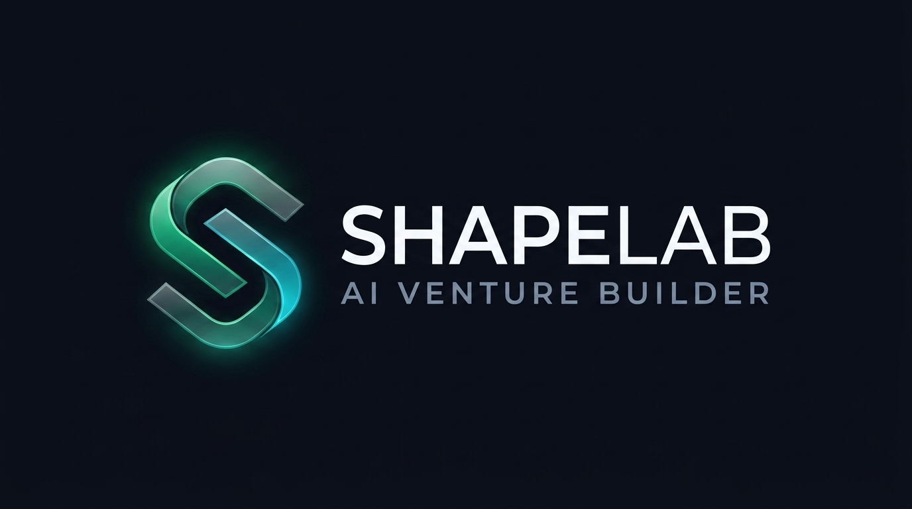

# 🧠 Shapelab Brain — Agent OS (v2.4)

Repositório central de inteligência, governança arquitetural, identidade visual, memória viva e *skills* de produção da **Shapelab (`shapelab.ia.br`)**, integrado nativamente ao plugin **`shapelab-os` (`ShapeLab OS v3.0`)** com Lifecycle Hooks de auto-aprendizado no Google Antigravity.

## Ponto de Entrada
- **[INDEX.md](./INDEX.md)** — Roteador de contexto sob demanda (*lazy-loading*) e mapeamento para os 5 subagentes da Squad ShapeLab.
- **[CORE_CONSTITUTION.md](./CORE_CONSTITUTION.md)** — Diretrizes globais inegociáveis (Protocolo Spec-First Gate, Zero-Downtime, Auth Anti-Takeover, Fintech BCB 4893, Supabase RLS, Versionamento/OTA e Loop Fechado de Evolução).
- **[memory/PRODUCT_MATRIX.md](./memory/PRODUCT_MATRIX.md)** — Matriz viva de adoção de skills e sincronia entre todos os SaaS.
- **[scripts/brain_doctor.ps1](./scripts/brain_doctor.ps1)** — Healthcheck 360º do plugin `shapelab-os`, integridade do Brain e sincronia dos submódulos.
- **[skills/brand/shapelab_brand_identity.md](./skills/brand/shapelab_brand_identity.md)** & **[assets/brand/brand_manifest.json](./assets/brand/brand_manifest.json)** — Guia oficial de marca (Prism S + Efeito Neon) legível por humanos e agentes de IA para aplicação em `shapelab.ia.br`, PWA e apps Flutter.
- **[shapelab_brain_blueprint.md](./shapelab_brain_blueprint.md)** — Documento completo de especificação do ecossistema.

## Produtos Conectados (`PROJETOS 2026`)
1. **Mr. Coach** (`B2B-personal-ia`)
2. **ReformAI** (`ReformAI`)
3. **Smart EV Hub** (`Smart-EV-Hub`)
4. **Tattoo SaaS** *(Planejado)*
